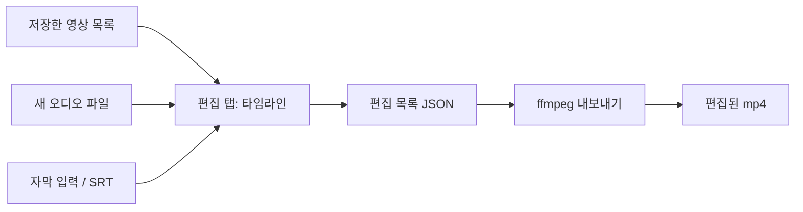

# 영상 편집 기능 추가 계획 (초안 v0.1)

> 상태: **승인 대기**. 승인 전에는 코딩하지 않는다.

## 0. 목표

다운로드한 영상을 이 프로그램 안에서 간단히 편집한다. 캡컷 전체가 아니라 아래 기능만 넣는다.

1. 자르기 / 나누기 / 이어 붙이기
2. 오디오: 원본 음소거, 새 오디오(음악·녹음 파일) 입히기, 볼륨, 페이드
3. 자막: 직접 입력(시간 지정), SRT 불러오기, 영상에 입히기(하드섭), SRT로 내보내기
4. 보조: 재생 속도, 화면 비율(9:16, 1:1, 16:9), 간단한 글자 얹기
5. (선택) 자동 자막 생성(음성 인식)

## 1. 핵심 결정: CapCut 분석(REA)은 쓰지 않는다

- 캡컷의 영상 편집 기능은 **ffmpeg**(이미 프로그램에 들어 있음)로 모두 만들 수 있다.
  확인: 번들 ffmpeg 9.0.2는 자막 입히기(libass) 필터를 지원한다.
- REA로 캡컷 프로그램 파일을 해체해서 기능을 가져오는 것은 하지 않는다.
  캡컷 이용약관이 역분석을 금지하고, 필요하지도 않다.
- 대신 **캡컷 화면을 보고 "어떤 기능이 어디에 있는지"만 참고**한다. 이건 사용자가 캡컷을 실행한 화면 캡처를 주시면 충분하다.

## 2. 구조 (기획자용 설명)

- **편집 목록(프로젝트 파일)**: "원본 A의 10~25초 + 원본 B의 3~8초, 음악 C, 자막 3줄"처럼 편집 내용을 글로 적어 둔 JSON 파일.
  화면은 이 목록을 고치는 도구이고, 마지막에 ffmpeg이 이 목록대로 한 번에 영상을 만든다. (원본은 절대 건드리지 않는다.)
- **화면**: 기존 화면에 "편집" 탭을 추가. 사이드바 저장 목록에서 영상을 고르면 편집 탭으로 불러온다.
  위: 미리보기 플레이어 / 아래: 타임라인(영상 줄, 오디오 줄, 자막 줄).
- **미리보기**: 브라우저 플레이어로 즉시 재생(자르기·자막은 화면에서 바로 반영). 최종 결과는 내보내기로 확인.
- **내보내기**: 진행률 표시, 취소 가능. 기존 다운로드 진행 표시줄 재사용.

## 3. 개발 단계 (한 단계 = 직접 실행해서 확인 가능한 크기)

| 단계 | 내용 | 내가 확인하는 방법 | 버전 |
|---|---|---|---|
| 1 | 편집 탭 뼈대: 저장 영상 불러와 재생, 편집 목록 저장/열기 | 영상을 골라 편집 탭에서 재생 | 0.2.0 |
| 2 | 자르기·나누기·이어 붙이기 + 내보내기 | 10~20초만 잘라 mp4로 저장, 재생 확인 | 0.3.0 |
| 3 | 오디오: 음소거, 새 오디오 입히기, 볼륨, 페이드 | 영상에 내 음악 파일을 입혀 내보내기 | 0.4.0 |
| 4 | 자막: 직접 입력, SRT 불러오기/내보내기, 영상에 입히기(한글 폰트 포함) | 한글 자막이 영상에 나오는지 확인 | 0.5.0 |
| 5 | 보조 기능: 속도, 화면 비율, 글자 얹기 | 세로 9:16 영상으로 내보내기 | 0.6.0 |
| 6 | (선택) 자동 자막(음성 인식) | 영상에서 자막 초안 자동 생성 | 0.7.0 |
| 7 | 마무리: 오류 처리, 포터블 재빌드, 문서(구성도·기능 설명서) | 포터블 exe에서 전체 흐름 동작 | 1.0.0 |

각 단계 끝: ruff + semgrep 경고 0개 → 직접 실행 테스트 → `CHANGELOG.md` 기록 → 한국어 커밋 → 보고 후 "진행해" 대기.

## 4. 필요한 것

### 4-1. 에이전트 (필요할 때만 호출)

| 에이전트 | 쓰는 시점 |
|---|---|
| Architect | 3단계 전에 편집 목록(JSON) 구조 설계 검토 |
| Artisan / Advocate | 1·2단계 타임라인 화면 설계, 사용성 점검 |
| Craftsman | 2~5단계 테스트 전략, 샘플 영상으로 자동 테스트 |
| Skeptic | 내보내기 오류·긴 영상·특수문자 파일명 등 위험 점검 |
| Tuner | 긴 영상 내보내기 속도 점검(필요 시) |
| Chronicler | 7단계 문서 정리 |

### 4-2. 도구

- 이미 있음: ffmpeg/ffprobe(자막 필터 포함), ruff, semgrep(WSL), git, 내장 브라우저(화면 테스트)
- 새로 필요:
  - `pytest` — 편집 목록 → ffmpeg 명령 변환 테스트 (무료)
  - 한글 자막용 폰트 1개(예: Noto Sans KR, 무료 오픈 라이선스) — 프로그램 폴더에 포함
  - (6단계 선택) `faster-whisper` + 음성 인식 모델 — 무료, 모델 다운로드 약 0.5~1.5GB

### 4-3. MCP

- `context7`(설치 완료): ffmpeg/FastAPI/라이브러리 최신 사용법 확인
- `sequential-thinking`(설치 완료): 3개 이상 파일을 동시에 고칠 때 영향도 분석
- 내장 브라우저(`Claude_Browser`): 편집 화면 동작 확인
- REA: **사용하지 않음** (위 1번 참고)

### 4-4. 스킬

- `run`: 앱을 실제로 띄워 동작 확인
- `code-review`, `simplify`: 단계 끝마다 점검
- `studio-setup`: 문서·버전 관리 템플릿 정리가 필요할 때(선택)

## 5. 준비물 체크리스트

**클로드가 직접 하는 것**
- `pytest` 설치, 한글 폰트 내려받기(무료 폰트), 테스트용 짧은 샘플 영상 만들기(ffmpeg으로 생성)
- 편집 목록 구조 설계, 화면·서버 코드, 테스트, 문서, 커밋

**내가 직접 하는 것**
1. 이 계획 검토 후 승인 (아래 "확인 필요" 질문에 답)
2. 캡컷에서 **꼭 필요한 기능** 순서 정하기 (화면 캡처가 있으면 참고)
3. 테스트용으로 쓸 새 오디오 파일 1개(없으면 제가 무료 효과음을 만들어 씀)
4. 각 단계 결과를 직접 써 보고 "진행해" 말하기

**비용**: 전부 무료. (6단계 음성 인식 모델만 용량 필요)

## 6. 확인 필요 (승인 전에 답해주세요)

1. 6단계(자동 자막)를 넣을지, 뺄지?
2. 내보내기 기본 형식: mp4(H.264)로 고정해도 되는지?
3. 편집 결과는 원본과 **별도 파일**로 저장(원본 보존)해도 되는지? (권장)
4. 한 번에 이어 붙일 영상은 여러 개까지 필요한지, 하나만 자르는 정도면 되는지?

## 7. 위험과 대응

- 브라우저 미리보기는 일부 코덱(예: AV1)을 못 틀 수 있음 → 이 경우 임시 저화질 미리보기 파일 생성(필요 시 추가).
- 한글 자막은 폰트가 없으면 깨짐 → 폰트를 프로그램에 포함.
- 자르기만 하는 경우 재인코딩 없이 빠르게 자르면 시작 지점이 몇 프레임 어긋날 수 있음 → "빠르게(약간 어긋남) / 정확하게(느림)" 선택지 제공.
- 포터블 용량 증가(폰트, 선택 시 음성 인식 모델) → 6단계는 선택 설치로 분리.
